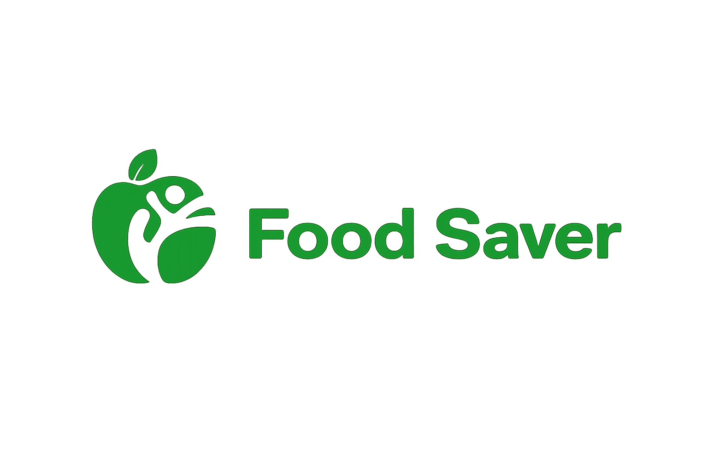

# 🍃 Food Saver — Reduce Food Waste, Share Hope

<p align="center">
  
</p>

<h3 align="center">Save Food. Share Hope. Make a Difference.</h3>

<p align="center">
  A responsive frontend website designed to connect food donors with people and organizations in need.
</p>

<p align="center">
  <a href="https://food-saverrr.vercel.app/"><strong>🌐 View Live Website</strong></a>
  |
  <a href="https://github.com/hisrak/Food-Saver"><strong>💻 GitHub Repository</strong></a>
</p>

---

## 🌐 Live Website

**Visit Food Saver:**  
https://food-saverrr.vercel.app/

**GitHub Repository:**  
https://github.com/hisrak/Food-Saver

---

## 📌 About the Project

Food Saver is a frontend web development project focused on reducing food waste and promoting food sharing.

The platform aims to connect restaurants, food businesses, donors, NGOs, and communities so that surplus food can reach people who need it instead of being wasted.

The website provides a clean, modern, and user-friendly interface to introduce the platform and its services.

## ✨ Features

- 🏠 **Home Page** — An attractive landing page introducing Food Saver.
- ℹ️ **About Page** — Information about the platform and its mission.
- 🔐 **Login Page** — User login interface.
- 📝 **Register Page** — User registration interface.
- 🔄 **How It Works** — Explains the food-sharing process.
- 🛠️ **Services Page** — Highlights the platform's services.
- 📩 **Contact Page** — Contact information and inquiry interface.
- 📱 **Responsive Design** — Designed for desktop, tablet, and mobile screens.
- 🎨 **Modern UI** — Clean layout, attractive styling, and easy navigation.
- 🌱 **Environmental Awareness** — Promotes food waste reduction and responsible food sharing.

> **Note:** This is currently a frontend project. Login and registration pages provide user interfaces; backend authentication and database functionality can be implemented in future development.

## 🛠️ Technologies Used

| Technology | Purpose |
|---|---|
| HTML5 | Website structure |
| CSS3 | Styling and layout |
| JavaScript | Interactive functionality |
| Bootstrap 5 | Responsive design |
| Bootstrap Icons | Interface icons |
| Visual Studio Code | Code editor |
| Git & GitHub | Version control and project hosting |
| Vercel | Website deployment |

## 📂 Project Structure

```text
Food-Saver/
│
├── index.html
├── about.html
├── login.html
├── register.html
├── how-it-works.html
├── services.html
├── contact.html
│
├── css/
│   └── auth.css
│
├── js/
│   └── auth.js
│
├── images/
│   ├── logo.png
│   ├── image.png
│   ├── image-1.png
│   ├── image-2.png
│   ├── image-3.png
│   └── image-4.png
│
└── README.md

## 🚀 Getting Started

Follow these steps to run the project locally.

### 1. Clone the Repository

```bash
git clone https://github.com/hisrak/Food-Saver.git
```

### 2. Open the Project Folder

```bash
cd Food-Saver
```

### 3. Open in Visual Studio Code

```bash
code .
```

### 4. Run the Website

Open `index.html` in your browser or use the **Live Server** extension in Visual Studio Code.

## 🎯 Project Goals

- Promote food donation and sharing.
- Reduce unnecessary food waste.
- Create awareness about food sustainability.
- Encourage community participation.
- Provide a simple and accessible web interface.

## 🔮 Future Improvements

The following features can be added in future development:

- Backend development using ASP.NET Core MVC.
- User authentication and authorization.
- Database integration using SQL Server.
- Donor and NGO dashboards.
- Food donation management system.
- Food pickup and delivery tracking.
- Real-time notifications.
- Admin panel for platform management.

## 👩‍💻 Developed By

**Hisra Khan**

Software Development Student | Frontend Developer

- **GitHub:** [@hisrak](https://github.com/hisrak)
- **Project Repository:** [Food Saver](https://github.com/hisrak/Food-Saver)
- **Live Website:** [Food Saver](https://food-saverrr.vercel.app/)

## 📄 License

This project is developed for educational and learning purposes.

---

<p align="center">
  <strong>🍃 Save Food. Share Hope. Build a Better Future.</strong>
</p>

### 💚 Save Food, Share Hope, Protect Our Planet! 🌍🍃
