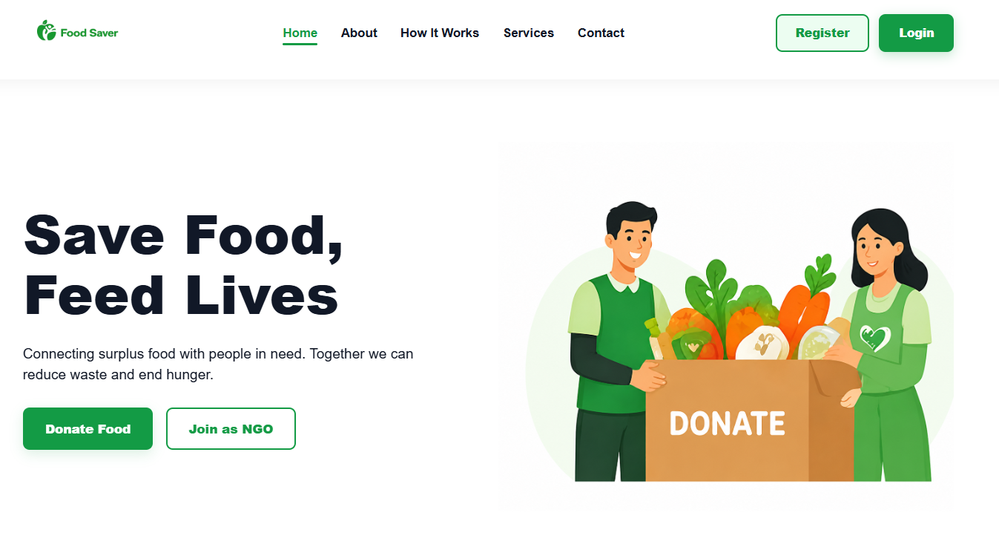
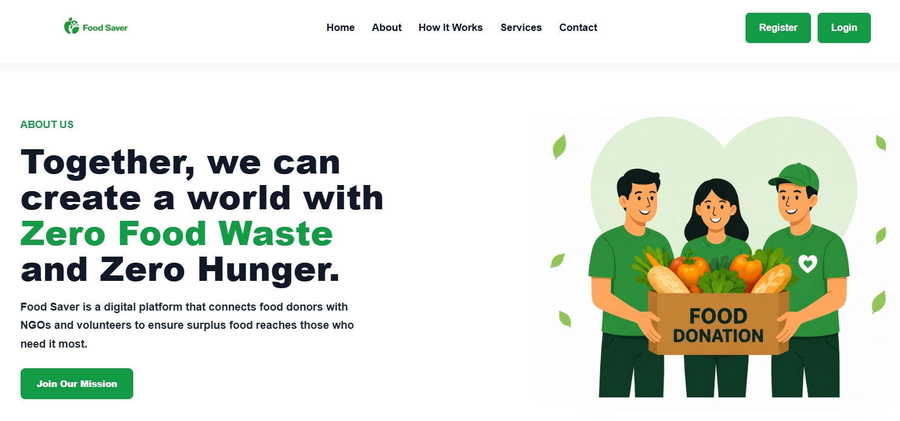
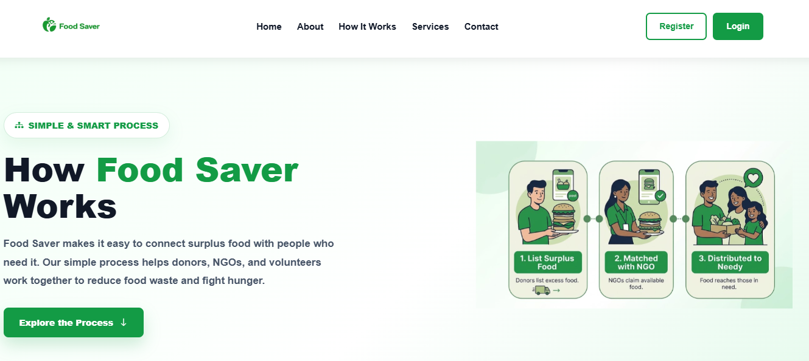
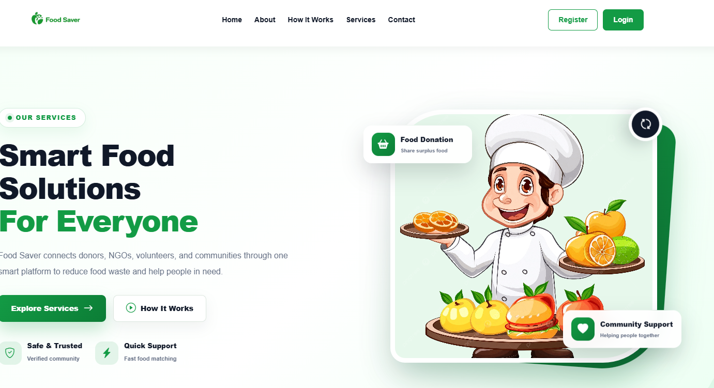
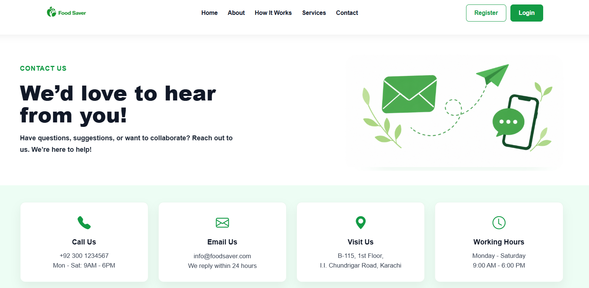
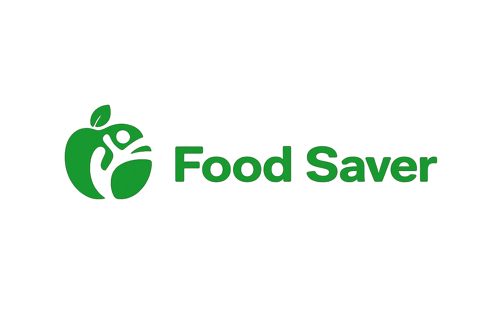

# 🍃 Food Saver — Reduce Food Waste, Share Hope

Welcome to **Food Saver**! 🌍💚

Food Saver is a web-based project designed to help reduce food waste and promote responsible food sharing. It provides a simple and user-friendly interface to encourage people to save food, share resources, and contribute to a better environment.

## 📌 About the Project

Every day, a large amount of food goes to waste while many people need food. Food Saver aims to spread awareness about food waste and encourage sustainable habits through a clean, responsive, and easy-to-use website.

This project is developed using **HTML, CSS, JavaScript, and Bootstrap**.

## ✨ Features

- 🏠 **Home Page** — Introduces the Food Saver project.
- ℹ️ **About Page** — Explains the purpose and mission of Food Saver.
- 🔐 **Login Page** — Provides a login interface for users.
- 📝 **Register Page** — Provides a registration interface for new users.
- ⚙️ **How It Works** — Explains the basic working process.
- 🛠️ **Services Page** — Presents the services offered by the project.
- 📩 **Contact Page** — Provides a way for visitors to get in touch.
- 📱 **Responsive Design** — Uses Bootstrap to support different screen sizes.
- 🎨 **User-Friendly Interface** — Includes navigation, styling, and visual elements.
- 🌱 **Environmental Awareness** — Promotes reducing food waste and responsible food use.

> Note: Login and registration are currently frontend interfaces unless backend authentication has been implemented separately.

## 🖥️ Technologies Used

- 🌐 HTML5
- 🎨 CSS3
- ⚡ JavaScript
- 🅱️ Bootstrap 5
- 🖼️ Bootstrap Icons
- 💻 Visual Studio Code
- 🐙 Git and GitHub

## 📂 Project Structure

```text
Food-Saver/
│
├── index.html
├── about.html
├── login.html
├── register.html
├── how-it-works.html
├── services.html
├── contact.html
│
├── css/
│   └── auth.css
│
├── js/
│   └── auth.js
│
├── images/
│   └── logo.png
│
├── image.png
├── image-1.png
├── image-2.png
├── image-3.png
├── image-4.png
│
└── README.md
```

## 📸 Project Screenshots

### 🏠 Homepage



### 📷 Website Preview 1



### 📷 Website Preview 2



### 📷 Website Preview 3



### 📷 Website Preview 4



## 🚀 Getting Started

Follow these steps to run the project on your computer.

### 1️⃣ Clone the Repository

Open your terminal or command prompt and run:

```bash
git clone https://github.com/hisrak/Food-Saver.git
```

### 2️⃣ Open the Project Folder

```bash
cd Food-Saver
```

### 3️⃣ Open in Visual Studio Code

```bash
code .
```

### 4️⃣ Run the Website

- Open the project folder in Visual Studio Code.
- Open `index.html`.
- Run it in your browser, or use the **Live Server** extension for a convenient development experience.

## 🖼️ Logo

The project logo is stored in the `images` folder.

```html

```

## 🌱 Project Goals

- ♻️ Encourage people to reduce food waste.
- 🍎 Promote responsible food consumption.
- 🤝 Spread awareness about food sharing.
- 🌍 Support a cleaner and more sustainable environment.
- 💚 Inspire small actions that can make a positive difference.

## 🔮 Future Improvements

Possible future enhancements include:

- 👤 User authentication with a backend.
- 🥗 Food donation and food-sharing functionality.
- 📍 Location-based food donation listings.
- 📊 Food waste tracking and statistics.
- 🗄️ Database integration.
- 🔔 Notifications for available food donations.
- 🔒 Improved user security and validation.

## 👩‍💻 Author

**Hisra Khan**

GitHub: [@hisrak](https://github.com/hisrak)

## 📜 License

This project is created for educational and learning purposes. You may adapt it for personal learning and development.

---

### 💚 Save Food, Share Hope, Protect Our Planet! 🌍🍃
